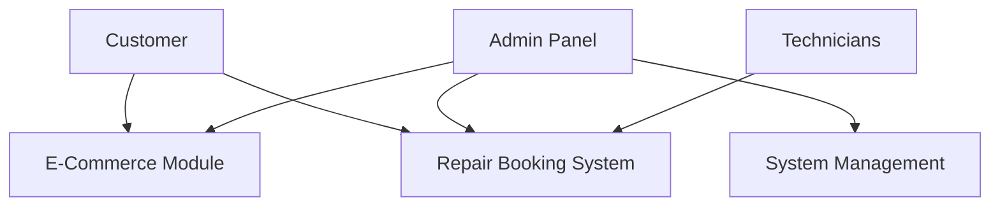
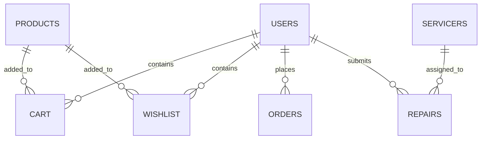
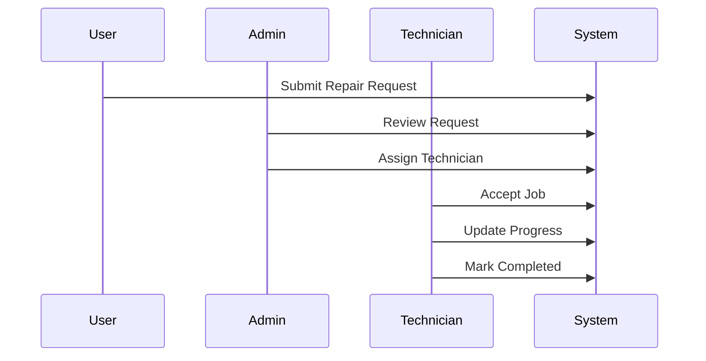

# 📦 VK3_SYSTEMS – Computer Spare Parts & Repair Management System


---

## 📌 Overview

**VK3_SYSTEMS** is a full-stack PHP-based web application that integrates:

- 🛒 Computer spare parts e-commerce system  
- 🔧 Computer repair booking and dispatch system  
- 👨‍💼 Role-based admin, customer, and technician portals  
- 🗺️ Real-time location tracking with interactive maps  
- 🎨 Modern UI with 3D visual elements and animations  

This system is designed to simulate a **real-world service-based business platform**, combining online shopping with field service management.

---

## 🎯 Objectives

- Build a scalable e-commerce + service booking platform
- Implement role-based access control (RBAC)
- Enable real-time repair request tracking
- Integrate map-based location selection system
- Demonstrate clean PHP + MySQL architecture

---

## 👥 User Roles & Features

### 🧑 Customers
- Register and login securely
- Browse computer spare parts
- Add products to cart and wishlist
- Place orders and track status
- Submit repair requests with location pin
- Contact admin via support system

---

### 🛠️ Administrators
- Manage users, products, and technicians
- Approve or reject repair requests
- Assign technicians to repair jobs
- Monitor sales and system analytics
- Manage advertisements and homepage content
- Control order statuses and payments

---

### 👨‍🔧 Technicians (Servicers)
- View assigned repair jobs
- Access customer details and location maps
- Update job status (Pending → In Progress → Completed)
- Automatically update availability status

---

## 🏗️ System Architecture



---

## 🗄️ Database Design



---

## 🧩 Modules Breakdown

### 🛒 E-Commerce Module

- Product catalog with categories
- Product quick view system
- Cart and wishlist management
- Checkout and order processing
- Order tracking system

---

### 🔧 Repair Management System

- Repair request submission form
- OpenStreetMap location selection
- Admin approval workflow
- Technician assignment system
- Live status tracking system

---

### 📊 Admin Dashboard

- Total users, orders, revenue overview
- Product management system
- Repair request monitoring
- Technician allocation system
- Advertisement/banner management

---

### 👨‍🔧 Technician Dashboard

- Assigned job list
- Customer location map integration
- Job progress updates
- Availability status control

---

## ⚙️ Technology Stack

### Backend
- PHP (Procedural + PDO)
- MySQL / MariaDB

### Frontend
- HTML5
- CSS3 (Glassmorphism UI, animations, dark theme)
- JavaScript (Vanilla ES6)

### APIs & Libraries
- 🗺️ Leaflet.js (Interactive Maps)
- 📍 OpenStreetMap + Nominatim API (Geolocation)
- 🌍 Google Maps Embed API
- 🎨 Spline 3D Viewer (UI enhancement)
- ⭐ FontAwesome Icons

---

## 🔄 System Workflow

### 🔧 Repair Request Lifecycle



---

## 🔐 Security Analysis

### ⚠️ Issues Identified

#### 1. Password Security
- Users/Admins use `SHA1`
- Technicians use `bcrypt`

✔ Recommended:
- Upgrade all authentication to `password_hash()` (bcrypt/argon2)

---

#### 2. SQL Injection Risk
- Some queries use direct variable concatenation

✔ Recommended:
- Use prepared statements everywhere (PDO)

---

#### 3. Input Validation
- Deprecated `FILTER_SANITIZE_STRING`

✔ Recommended:
- Replace with `htmlspecialchars()` and strict validation

---

#### 4. Error Handling
- Missing try-catch blocks in DB operations

✔ Recommended:
- Implement centralized exception handling

---

## 📈 Future Improvements

- 🔗 REST API integration (mobile app support)
- ⚡ Real-time WebSocket updates
- 💳 Payment gateway integration (Stripe/PayHere)
- 📊 Advanced analytics dashboard
- 🧠 AI-based repair prediction system
- ☁️ Cloud deployment (AWS / Azure)

---

## 🧑‍💻 Project Info

- 🎓 Module: SENG 21253 - Web Application Development
- 👨‍👩‍👧 Team Project (Group Work)
- 🏫 Academic Level: Undergraduate Software Engineering
- 📅 Status: Completed

---

## ⭐ Key Highlights

- Full-stack PHP architecture
- Dual system: e-commerce + service dispatch
- Real-time location tracking
- Role-based access control
- Professional UI with modern design
- Scalable relational database design

---

## 🤝 Contributors

- Team Project (4 Members)      
    Member 1 - V.Vanushan  
    Member 2 - K.Kasturi  
    Member 1 - K.Kavishana  
    Member 2 - S.Krishnapiriyan  
  
- Software Engineering Undergraduate Group
```
